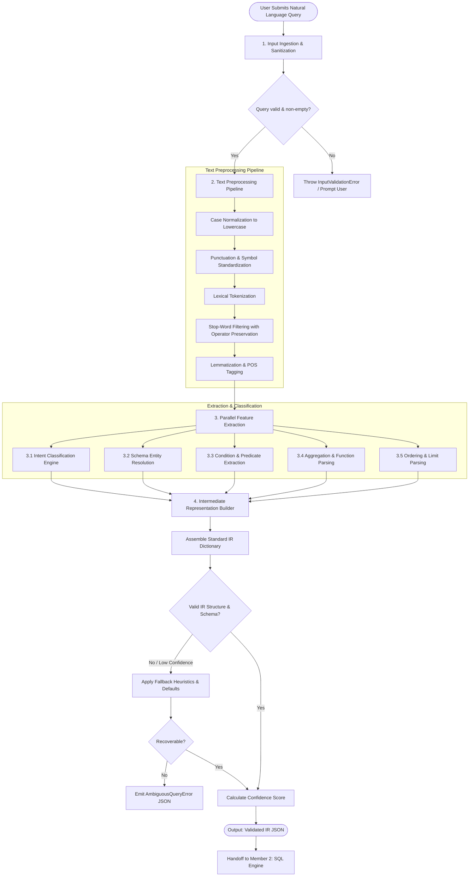
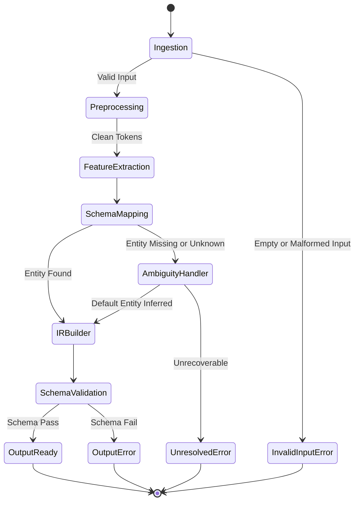

# Flow File (Flowchart File)
## Project: QueryMind AI — Natural Language to SQL Query Assistant
### Module: Member 1 — NLP Engine & Natural Language Understanding

---

## 1. Overview
The **Flow File** depicts the operational lifecycle and step-by-step decision workflow of the **Member 1 (NLP Engine)**. It maps the end-to-end journey of an input query from the moment an end-user types a natural language question until a fully validated Intermediate Representation (IR) JSON is produced for the SQL Engine (Member 2).

---

## 2. System Workflow Diagram (Mermaid)



---

## 3. Step-by-Step Workflow Execution Trace

### Phase 1: Input Ingestion & Sanitization
1. **Entry**: User inputs string e.g., `"Show all students having CGPA greater than 8.5"`.
2. **Length & Type Check**: Asserts query is a non-empty string with length between 3 and 500 characters.
3. **Punctuation Clean**: Eliminates trailing commas, question marks, and unifies comparative symbols.

### Phase 2: Preprocessing Pipeline
1. **Normalization**: `"show all students having cgpa greater than 8.5"`
2. **Tokenization**: `['show', 'all', 'students', 'having', 'cgpa', 'greater', 'than', '8.5']`
3. **Stop-word Cleaning**: Drops conversational noise like `'all'`; preserves contextual triggers `'greater'`, `'than'`, `'having'`.
4. **Lemmatization**: Maps `'students'` -> `'student'`, maintaining lemma tokens alongside original tokens.
5. **POS Tagging**: Identifies `'students'` (Noun), `'cgpa'` (Noun), `'greater'` (Comparative Adjective), `'8.5'` (Number).

### Phase 3: Extraction & Intent Resolution
1. **Intent Classification**:
   - Detection of conditional markers (`"having"`, `"greater than"`) classifies primary intent as **`FILTER`**.
2. **Schema Resolution**:
   - Detects entity token `'student'` / `'students'`. Matches with database table **`students`**.
   - Detects attribute `'cgpa'`. Matches with table column **`cgpa`**.
   - Default projection attributes selected: `["name", "cgpa"]`.
3. **Condition Extraction**:
   - Identifies comparison phrase `"greater than"` -> relational operator **`>`**.
   - Identifies numeric literal `'8.5'` -> float value **`8.5`**.
   - Associates column `'cgpa'` with operator `>` and value `8.5`.
   - Condition object created: `{"column": "cgpa", "operator": ">", "value": 8.5}`.
4. **Ordering & Limit Extraction**:
   - No ordering keywords detected -> `order_by: null`.
   - No explicit limit detected -> `limit: null`.

### Phase 4: Intermediate Representation (IR) Assembly
1. Consolidates extracted components into the agreed JSON schema format:
```json
{
  "intent": "FILTER",
  "table": "students",
  "columns": ["name", "cgpa"],
  "conditions": [
    {
      "column": "cgpa",
      "operator": ">",
      "value": 8.5
    }
  ],
  "order_by": null,
  "limit": null,
  "confidence_score": 0.95
}
```

### Phase 5: Schema Validation & Delivery
1. Validates required keys (`intent`, `table`, `columns`, `conditions`, `order_by`, `limit`).
2. Checks data types and allowed operator enums.
3. Computes confidence score (0.95).
4. Hands over JSON payload to Member 2 (SQL Engine).

---

## 4. Alternative Workflows & Exception Handling


