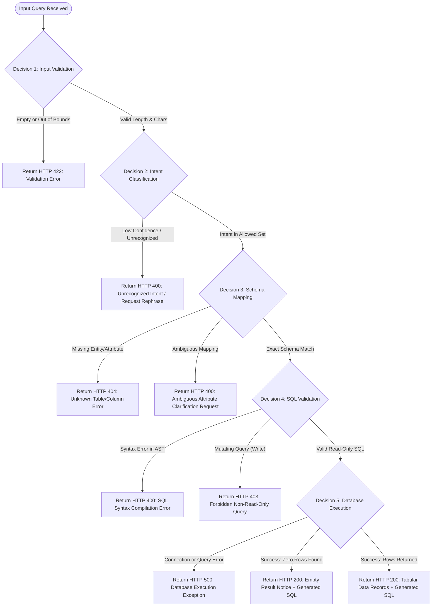

# Decision Logic Design (DECISION_FILE) — QueryMind AI

## 1. Overview

This document formalizes the decision logic, branch points, and rule evaluation matrices governing **QueryMind AI**. It provides rigorous criteria for handling every state transition, input permutation, validation condition, and failure scenario.

> **Status Notice:**  
> The rules, decision tables, pseudocode routines, and logic trees documented here constitute the **proposed architectural decision contracts**. In the **Day 1** release, the FastAPI application foundation and base endpoints (`GET /` and `GET /health`) are active. Query input validation rules, downstream NLP, schema mapping, SQL validation, and database decision branches are planned for subsequent phases.

---

## 2. Decision Logic Flowchart



---

## 3. Decision 1: Input Validation & Sanitization

### 3.1 Conditions & Business Rules
1. **Rule 1.1 (Emptiness):** If the input string is empty, `null`, or comprises solely whitespace characters, the request is rejected immediately.
2. **Rule 1.2 (Length Bounds):** If string length is `< 3` characters or `> 500` characters, reject with range validation details.
3. **Rule 1.3 (Character Set):** Must not contain control characters or obvious SQL injection meta-commands (e.g., `; DROP TABLE`).

### 3.2 Decision Table

| Condition | Check Description | Action Taken | HTTP Code | Status |
| :--- | :--- | :--- | :--- | :--- |
| `len(trim(query)) == 0` | Input is empty | Reject with "Query string cannot be empty" | 422 Unprocessable | Planned |
| `len(query) < 3` | Query too short | Reject with "Query must be at least 3 characters" | 422 Unprocessable | Planned |
| `len(query) > 500` | Query too long | Reject with "Query exceeds 500 character limit" | 422 Unprocessable | Planned |
| `contains_dangerous_tokens(query)` | Basic injection pattern | Reject with "Invalid characters or patterns detected" | 400 Bad Request | Planned |
| `All checks pass` | Input clean and well-formed | Pass query to NLP Engine | 200 / Continue | Planned |

### 3.3 Pseudocode

```python
def validate_input(query: str) -> None:
    trimmed = query.strip()
    if not trimmed:
        raise HTTPException(status_code=422, detail="Query cannot be empty.")
    if len(trimmed) < 3:
        raise HTTPException(status_code=422, detail="Query too short (min 3 chars).")
    if len(trimmed) > 500:
        raise HTTPException(status_code=422, detail="Query too long (max 500 chars).")
    # Proceed to pipeline
```

---

## 4. Decision 2: Intent Classification (Member 1)

### 4.1 Conditions & Business Rules
The NLP model classifies queries into one of six canonical intents:
1. `SELECT`: Projection of entities or attributes.
2. `FILTER`: Selection with conditional operators (`>`, `<`, `=`, `BETWEEN`).
3. `SORT`: Ordering records (`ASC`, `DESC`, `top n`).
4. `COUNT`: Cardinality calculations (`how many`).
5. `AGGREGATION`: Mathematical reductions (`average`, `sum`, `max`, `min`).
6. `JOIN`: Relational queries spanning multiple related tables.

If model classification confidence is below `0.70`, the intent is classified as `UNKNOWN`.

### 4.2 Decision Table

| Predicted Intent | Confidence Score | Decision / Outcome |
| :--- | :--- | :--- |
| `SELECT` \| `FILTER` \| `SORT` \| `COUNT` \| `AGGREGATION` \| `JOIN` | $\ge 0.70$ | Accept intent, generate Intermediate Representation |
| Any intent | $< 0.70$ | Reject: "Unable to understand intent. Please rephrase." |
| `OUT_OF_SCOPE` | Any | Reject: "Query is outside the academic domain scope." |

---

## 5. Decision 3: Schema Mapping (Member 2)

### 5.1 Conditions & Business Rules
1. **Entity Resolution:** The logical entity identified by NLP must map directly to an approved table in the PostgreSQL catalog (`students`, `courses`, `departments`, `enrollments`).
2. **Attribute Resolution:** Every requested column must belong to the resolved table.
3. **Ambiguity Detection:** If a column name exists in multiple join candidates without explicit table qualification, ambiguity is flagged.

### 5.2 Decision Table

| Entity Status | Column Status | Ambiguity Flag | Outcome |
| :--- | :--- | :--- | :--- |
| Found in Catalog | Found in Table | False | **Proceed to SQL Generation** |
| Not Found | Any | False | **Error:** "Entity '[name]' does not exist in schema." |
| Found in Catalog | Not Found in Table| False | **Error:** "Attribute '[col]' does not exist on table '[table]'." |
| Found in Catalog | Found in Multiple | True | **Error:** "Column '[col]' is ambiguous. Please specify context." |

---

## 6. Decision 4: SQL Validation & Security Guardrails (Member 2)

### 6.1 Conditions & Business Rules
1. **Syntax Integrity:** Generated SQL must successfully compile into an AST via SQLGlot without syntax errors.
2. **Strict Read-Only Enforcement:** Only `SELECT` statements are permitted. Statements containing `INSERT`, `UPDATE`, `DELETE`, `DROP`, `ALTER`, `TRUNCATE`, `GRANT`, `REVOKE`, or `EXEC` are strictly forbidden.
3. **Catalog Whitelisting:** All AST table and column identifiers must match approved catalog items.

### 6.2 Decision Table

| AST Parser Result | Root Statement Type | Mutation Tokens Detected | Decision |
| :--- | :--- | :--- | :--- |
| Valid AST | `Select` | None | **Authorize & Dispatch for Execution** |
| Syntax Error | Any | Any | **Reject:** "Generated SQL failed syntax verification." |
| Valid AST | Non-`Select` | Present | **Reject (HTTP 403):** "Mutating operations are forbidden." |

---

## 7. Decision 5: Database Execution & Result Formatting

### 7.1 Conditions & Business Rules
1. **Timeout Guardrail:** Query execution is bound to a strict timeout (e.g., 5.0 seconds).
2. **Zero-Result Handling:** Empty result sets (`0` rows) are treated as valid successful executions, not errors.
3. **Exception Sanitization:** Database connection errors or internal PostgreSQL failures must be sanitized to prevent leaking credentials, table structures, or hostnames to the client.

### 7.2 Decision Table

| Execution State | Row Count ($n$) | Client Status | Client Payload Content |
| :--- | :--- | :--- | :--- |
| Success | $n > 0$ | 200 OK | Records list, column names, row count, generated SQL |
| Success | $n == 0$ | 200 OK | Empty list, "No matching records found", generated SQL |
| Timeout | N/A | 504 Gateway Timeout | "Database query exceeded execution time limit." |
| DB Exception | N/A | 500 Server Error | "A database execution error occurred. Please try again." |
