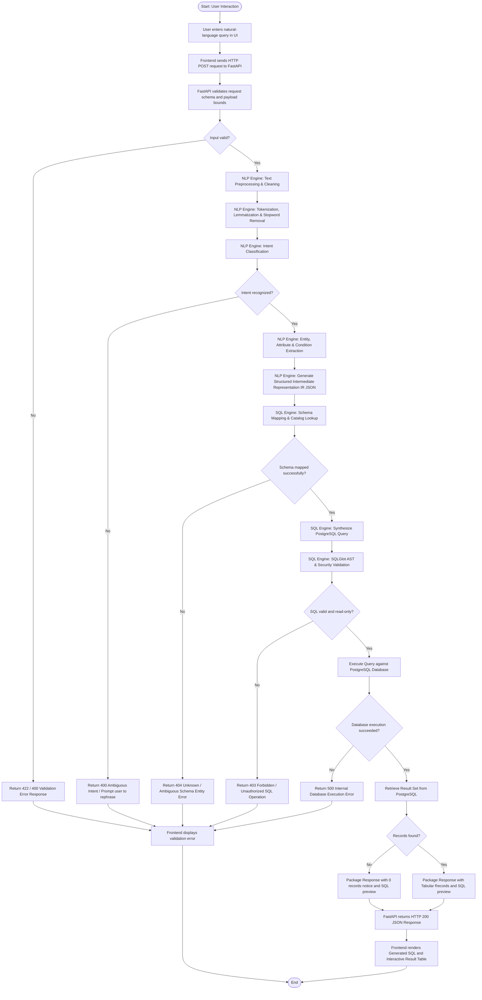

# System Workflow (FLOW_FILE) — QueryMind AI

## 1. Overview

This document specifies the end-to-end operational workflow of **QueryMind AI**, charting the transformation of natural language into structured database query results. It details every processing stage, data transition boundary, validation checkpoint, and error handling branch.

> **Status Notice:**  
> The workflow outlined below represents the **planned complete system pipeline**. On **Day 1**, the FastAPI backend foundation and base endpoints (`GET /` and `GET /health`) are implemented and verified. The multi-stage NLP parsing, SQL translation, and database execution components are in active design and will be implemented in subsequent phases.

---

## 2. Complete Planned Workflow Diagram



---

## 3. Detailed Step-by-Step Execution Lifecycle

### Step 1: User Query Submission
The user accesses the QueryMind AI web interface and types a plain-English question into the search bar (e.g., *"Show students whose CGPA is greater than 8.5"*).

### Step 2: Client Request Transmission
The client application validates that the text field is not empty and dispatches an asynchronous HTTP POST request to the backend endpoint (`/api/v1/query`) with a JSON payload containing the query string.

### Step 3: API Ingestion & Input Guardrails
FastAPI receives the payload, passes it through Pydantic validators, checks string length constraints (3 to 500 characters), and sanitizes against illegal ASCII/binary characters.
- **Error Branch:** If validation fails, FastAPI returns HTTP 422 / 400 with a detailed error message describing the invalid field.

### Step 4: NLP Preprocessing (Member 1)
The sanitized query string is processed by the NLP pipeline:
- Case normalization (lowercase).
- Removal of extraneous punctuation while preserving mathematical operators (`>`, `<`, `=`, `!`).
- Tokenization and lemmatization (e.g., *"students"* → *"student"*).

### Step 5: Intent Classification (Member 1)
A machine learning classification model (trained on academic query corpora) evaluates the query to determine the target analytical intent (`SELECT`, `FILTER`, `SORT`, `COUNT`, `AGGREGATION`, `JOIN`).
- **Error Branch:** If intent confidence falls below the acceptance threshold (e.g., < 0.70), the system halts and returns a polite clarification request asking the user to rephrase.

### Step 6: Entity and Condition Extraction (Member 1)
Named Entity Recognition (NER) models and pattern matchers extract:
- Entities (e.g., *"students"*).
- Attributes / Columns (e.g., *"CGPA"*).
- Comparison operators (e.g., *"greater than"* → `>`).
- Values (e.g., `8.5`).

### Step 7: Intermediate Representation (IR) Serialization (Member 1)
The extracted tokens are packaged into a standard, structured JSON contract representing the query's semantic AST.

### Step 8: Schema Mapping (Member 2)
The SQL Engine ingests the IR JSON and cross-references extracted entities against the physical PostgreSQL database catalog:
- Validates that the entity `students` maps to the physical table `students`.
- Validates that the attribute `cgpa` exists as a column in `students`.
- **Error Branch:** If a referenced table or column does not exist or is ambiguous (e.g., *"grade"* could mean student grade or course level), an error response is returned indicating the unmapped element.

### Step 9: SQL Query Generation (Member 2)
The SQL Engine converts the IR into ANSI/PostgreSQL SQL syntax:
```sql
SELECT * FROM students WHERE cgpa > 8.5;
```

### Step 10: SQL Validation & Security Inspection (Member 2)
Using SQLGlot, the generated SQL string is parsed into an Abstract Syntax Tree (AST):
- Syntax check confirms proper grammatical structure.
- Security check enforces strict read-only compliance: any query containing tokens for `INSERT`, `UPDATE`, `DELETE`, `DROP`, `ALTER`, `TRUNCATE`, or `GRANT` is rejected immediately.
- **Error Branch:** If forbidden clauses or invalid syntax are detected, the system halts with an HTTP 403 / 400 error.

### Step 11: Database Execution (Member 2)
The validated, read-only query is executed against the PostgreSQL database engine via SQLAlchemy / psycopg connection pooling.
- **Error Branch:** If the database connection times out or throws an operational error, the exception is caught, logged, and returned as a safe HTTP 500 error without leaking internal connection credentials.

### Step 12: Result Retrieval & Empty Result Handling
The query returns execution records.
- If records exist, rows are serialized into JSON tabular format.
- If zero rows match the criteria, an empty list is structured with an informative status message (`"No matching records found"`).

### Step 13: Response Packaging & Delivery (Member 3)
FastAPI constructs the final JSON payload containing:
- `query`: Original natural language question.
- `generated_sql`: The exact SQL statement executed.
- `row_count`: Total number of matching rows.
- `data`: Array of row objects.
- `execution_time_ms`: Backend processing latency.

### Step 14: Client Display
The frontend receives the response and renders:
1. An inspection card displaying the generated SQL with syntax highlighting.
2. A responsive, sortable data table showing the result set.
